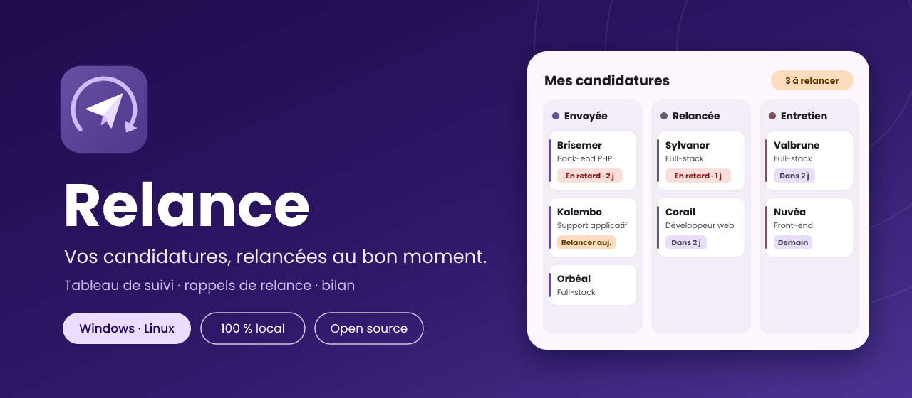
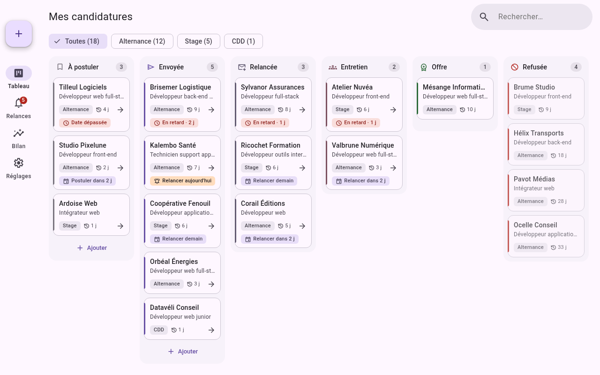
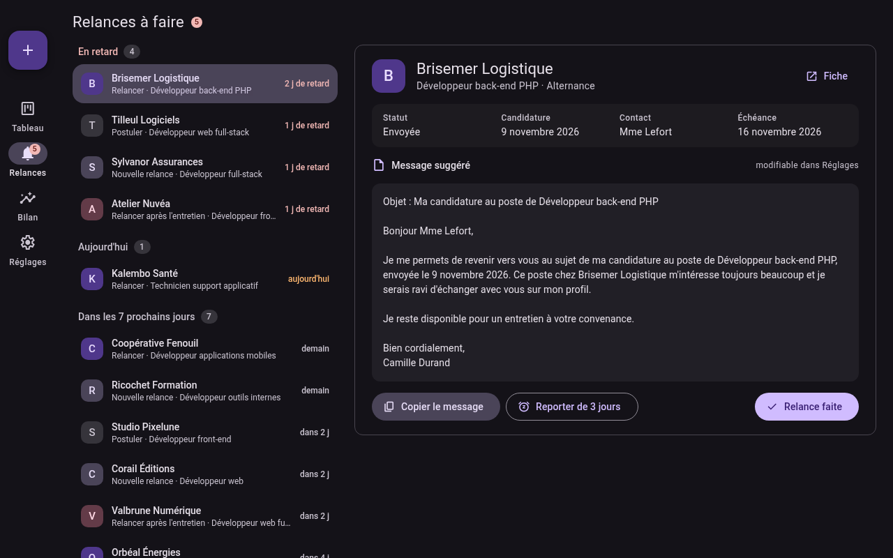
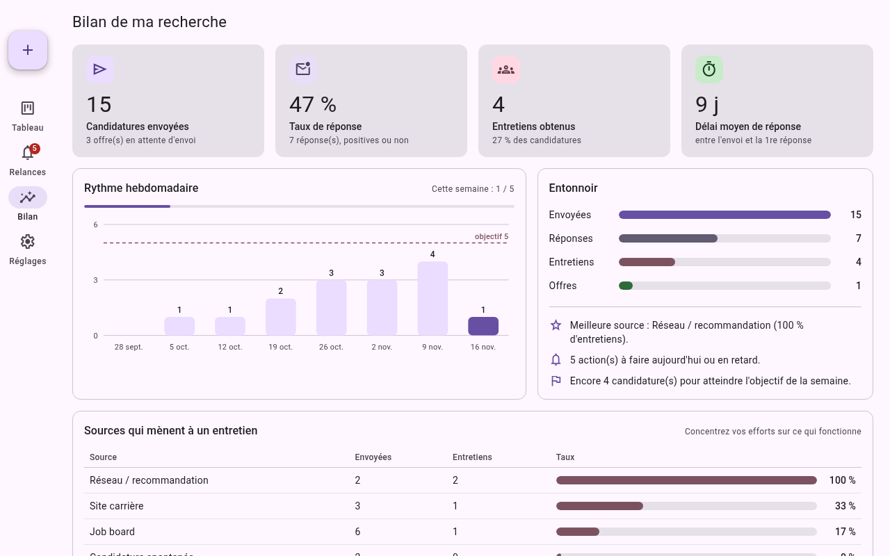
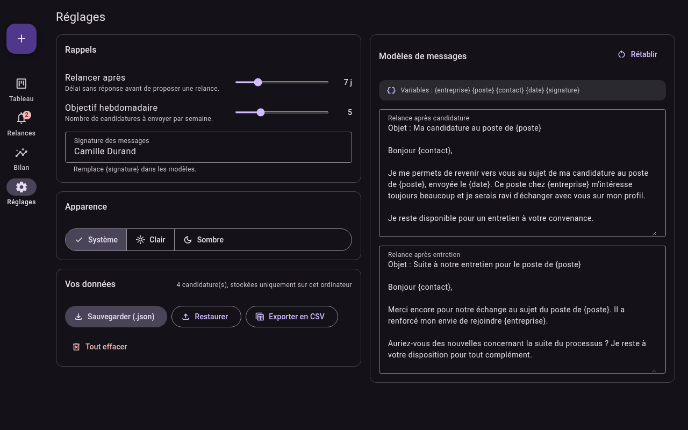

<p align="center">
  
</p>

<p align="center">
  <a href="https://github.com/JulesROGUE/relance/releases/latest"></a>
  
  
  <a href="LICENSE"></a>
</p>

<p align="center">
  <b>Suivez vos candidatures (alternance, stage, emploi) et sachez exactement quand relancer.</b><br>
  Un tableau clair, des rappels au bon moment, des messages prêts à copier. Tout reste sur votre ordinateur.
</p>

<p align="center">
  <a href="https://github.com/JulesROGUE/relance/releases/latest"><b>⬇️ Télécharger pour Windows ou Linux</b></a>
</p>

---

## Pourquoi Relance ?

Chercher une alternance, un stage ou un premier emploi, c'est envoyer des dizaines de candidatures sur des sites différents. Au bout de deux semaines, on ne sait plus à qui on a écrit, quand, ni s'il est temps de relancer. Et la recherche dure : selon une [enquête relayée par Diplomeo](https://diplomeo.com/actualite-seekube_enquete_stage_alternance_2024), elle dépasse trois mois pour 40 % des étudiants.

Les conseils de recherche d'emploi recommandent tous de **suivre ses candidatures et de relancer** après une semaine environ sans réponse. En pratique, cela finit souvent dans un tableur bricolé qu'on oublie de mettre à jour.

**Relance** remplace ce tableur par une vraie application de bureau :

- un **tableau** où chaque candidature avance d'étape en étape ;
- des **rappels** qui vous disent quoi relancer aujourd'hui, avec un **message prêt à copier** ;
- un **bilan** pour voir ce qui fonctionne (taux de réponse, sources qui mènent à un entretien).

Sans compte, sans connexion, sans publicité : vos données ne quittent jamais votre ordinateur.

## Aperçu

<p align="center">
  
  
</p>
<p align="center">
  
  
</p>

## Fonctionnalités

| | Fonctionnalité | Détail |
|---|---|---|
| 🗂️ | **Tableau de suivi** | Six étapes : À postuler, Envoyée, Relancée, Entretien, Offre, Refusée. Glisser-déposer ou bouton flèche pour passer à l'étape suivante. |
| 🔔 | **Rappels de relance** | Délai réglable (7 jours par défaut). Les actions sont classées en *En retard*, *Aujourd'hui* et *7 prochains jours*, avec un badge dans la navigation. |
| ✉️ | **Messages prêts à copier** | Modèles de relance après candidature et après entretien, remplis automatiquement : `{entreprise}`, `{poste}`, `{contact}`, `{date}`, `{signature}`. |
| 🕓 | **Historique et fiche complète** | Chaque changement d'étape est daté. Contact, lien de l'offre, notes, prochaine action, report de 3 jours en un clic. |
| 📊 | **Bilan** | Candidatures envoyées, taux de réponse, entretiens, délai moyen de réponse, rythme hebdomadaire face à votre objectif, sources les plus efficaces. |
| 🔎 | **Recherche et filtres** | Par entreprise, poste, lieu ou notes, et par type de contrat (alternance, stage, CDI, CDD, freelance). |
| 💾 | **Vos données** | Sauvegarde et restauration en JSON, export CSV pour un tableur, effacement complet. |
| 🌗 | **Thème clair ou sombre** | Suit le système ou se règle à la main. |
| 🔒 | **100 % local** | Aucune connexion réseau, aucun compte, aucune télémétrie. |

## Installation

Téléchargez la dernière version sur la [page des releases](https://github.com/JulesROGUE/relance/releases/latest) :

| Système | Fichier | Utilisation |
|---|---|---|
| Windows | `Relance-Setup-1.0.0.exe` | Installateur classique (menu Démarrer, désinstallation) |
| Windows | `Relance-1.0.0-portable.exe` | Version portable, sans installation (clé USB, poste sans droits admin) |
| Linux | `Relance-1.0.0-linux-x86_64.AppImage` | `chmod +x Relance-*.AppImage` puis double-clic |
| Linux (Debian, Ubuntu…) | `Relance-1.0.0-linux-amd64.deb` | `sudo apt install ./Relance-1.0.0-linux-amd64.deb` |

> **Windows SmartScreen** : l'exécutable n'est pas signé (un certificat de signature est payant). Au premier lancement, Windows peut afficher « Windows a protégé votre ordinateur ». Cliquez sur **Informations complémentaires** puis **Exécuter quand même**. Le code est public et les fichiers sont compilés par GitHub Actions à partir de ce dépôt.

**Où sont mes données ?** Dans le profil de l'application : `%APPDATA%\Relance` sous Windows, `~/.config/Relance` sous Linux. Pensez à faire une sauvegarde JSON depuis *Réglages* avant de changer d'ordinateur.

## Développement

Prérequis : Node.js 22 ou plus récent.

```bash
git clone https://github.com/JulesROGUE/relance.git
cd relance
npm install
npm start          # compile l'interface puis lance l'app Electron
npm run dev        # interface seule dans le navigateur (Vite)
npm run dist       # paquets Windows / Linux dans release/
```

| Couche | Outil |
|---|---|
| Interface | React 19 (JSX) |
| Design | Material You : composants maison, Material Symbols, Roboto (hors ligne) |
| Bureau | Electron 45 (page isolée, aucun accès Node dans l'interface) |
| Build | Vite 8, electron-builder 26 |
| Release | GitHub Actions : builds Windows et Linux à chaque tag `v*` |

```
src/
├── App.jsx                       navigation, état et actions
├── data.js                       modèle, dates, relances, statistiques, export
├── app.css                       styles propres à l'app
├── components/ApplicationDialog.jsx   fiche d'une candidature
├── views/                        Board, FollowUps, Stats, Settings
├── m3/                           composants Material You
└── lib/                          stockage local, fichiers, thème
```

## Licence

MIT © Jules ROGUE. Voir [LICENSE](LICENSE).

Icônes [Material Symbols](https://github.com/google/material-design-icons) © Google, sous licence Apache 2.0. Police [Roboto](https://fonts.google.com/specimen/Roboto) © Google, sous licence SIL Open Font License 1.1.
